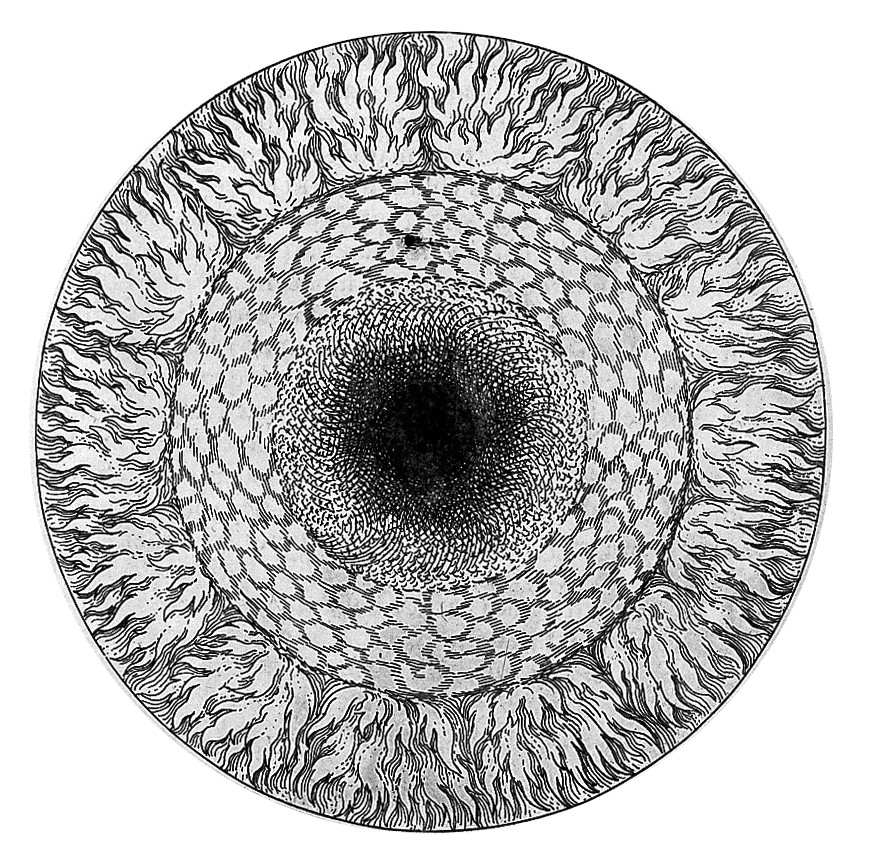

<p align="center">
  
  <br>
  <sub>Robert Fludd, <i>Utriusque Cosmi Maioris … Historia</i> (1617)</sub>
</p>

> [!IMPORTANT]
> This repo contains a lot of LLM generated code as of about Aug. 15th 2026.  
> Generally this is bad for the world as much as I wanna hem and haw about
> recycling all the embodied energy in this hardware, but it's also been really
> good for the maturity of this project and my own sanity as professionally 
> overwhelmed engineer.  Most of the important  parts of the design, the core 
> block diagram, hardware, and ring-modulated colour matrix mixer predate my 
> summoning with and bargaining with the **F**ascist **A**hrimanic **D**istributed 
> paywalled coding machine.  "AI" (I'm still linquistically miffed that they managed to
> steal this term) is functionally just a paywall.  "AI" as a term is being used as a dissonant 
> basket for many unrelated systems, and it seems the common factor is the paywall...
> pay for matrix multiplier hardware machine time and pay for stolen goods.  That said, 
> these systems can generate and test a month's of VDHL, C, **AND** javascript in an afternoon.
> One day this will all be obsolete too.

# DEBAZAROS

DEBAZAROS is a video playback and video-feedback unit. It is made from an
EBAZ4205 board, the control board of a discarded crypto-mining machine, plus a
small adapter PCB with three HDMI connectors. These boards are thrown away by
the thousand, but each one has a Zynq-7010 (two ARM cores and an FPGA) and
256 MB of DDR3. This project puts that hardware to full use, as an
installation of many units on one network.

One unit:

- plays movies or generated images on **two HDMI/DVI outputs**;
- **captures a third HDMI/DVI input** live into memory;
- mixes the two outputs into each other in the FPGA (**video feedback**), with
  gain stages, a per-pixel 3×3 colour matrix, a colour key, and two
  oscillators (DDS pattern engines with a sequencer and a drawn waveform);
- sends and receives **HDMI audio** (48 kHz stereo), with an ALSA sound card;
- reacts to sound: an FFT of the input audio drives any control;
- is controlled over the network with **OSC** (Open Sound Control), from a
  web app on the unit, and from cues (scenes and shows) stored on the unit;
- has six buttons, a 6-line GPIO header and two 12 V fan connectors as I/O.

> Status (Nov 2026): the 2-out/1-in design with HDMI audio works on the
> bench board at 720p60. The software runs on the board (web app, cues,
> datamosh, video wall, audio reactivity). Next: the SD card image with the
> software built in (PetaLinux recipe `debaz-sw`) and the fleet. See
> [ROADMAP.md](ROADMAP.md).

This repository started as a fork of Guido's
[EBAZ4205 SDR and Spectrum](https://github.com/guido57/EBAZ4205_Spectrum)
project. The radio parts are no longer used; see "Legacy folders" below.

## Hardware

| Part | Notes |
| --- | --- |
| EBAZ4205 | Zynq XC7Z010-1CLG400, 256 MB DDR3, ethernet, SD card. The ethernet PHY gets its 25 MHz clock from the FPGA, so every bitstream must keep that clock. |
| Adapter PCB `pcb/3xHDMI` (rev v2) | Power, three HDMI connectors on the EBAZ DATA1–3 headers, six buttons, header P1 (6 GPIO + 3V3 + GND). KiCad project and a JLCPCB release are in the folder. |
| Ports | HDMI_0 and HDMI_1 are outputs (DVI or HDMI with audio). HDMI_2 is an input (EDID: 720p60, 1080p30, 1280x960@60, 1280x1024@60, 1600x1200@30; 48 kHz stereo audio). |

The signals are TMDS at 3.3 V from the FPGA pins (DVI levels). Most HDMI
monitors accept them.

## How it works


| Diagram | Block design / software |
| --- | --- |
| Modulated channel → DVI/HDMI #0 output | `HDMI_0`: `mixerMatrix` (`/mixer/0..8/...`), `colorGainMain` (`/hdmi/0/gain`) |
| Matrix modulator #0–#8 | the 9 mixer channels; the keying modes are mode `0x10`–`0x13` and `0x20`–`0x23` |
| Pixel buffer / pixel delay | BRAM line delay = mixer stream B (`/hdmi/0/delay`) |
| Summed channel → DVI/HDMI #1 output | `HDMI_1`: `/hdmi/1/gain`, `/hdmi/1/osc/sin/...`, `/hdmi/1/osc/phase/...` |
| Feedback per-colour gain | `/hdmi/1/feedback` (output 0 into output 1) |
| Pass-through channel, DVI/HDMI #3 input | `HDMI_2` capture into DDR (`/disp/<d>/capture` shows it) |

The same data from the memory side:

```text
                 DDR3 frame slots (0x0800_0000, 6 slots of 1920x1080x4)
                   │ slot 0 = /dev/fb0             ▲ slot 4 = live input
                   ▼                                │
  ffmpeg ─► fbfeed ─►  VDMA ─► HDMI_0 effects ──┬──► TMDS out 0
  (or drawing)          │      (colour matrix,   │
                        │       mixer, DDS)  ◄───┼─── cross-feed
                        ▼                        │
                       VDMA ─► HDMI_1 effects ◄──┘──► TMDS out 1
                               (feedback gains,
                                oscillator layers)
  HDMI_2 in ─► dvi2rgb ─► vid_in ─► VDMA (write) ─► slot 4
```

- **PS (ARM, Linux):** PetaLinux 2022.2. Programs write frames into reserved
  DDR memory ("slots"). Each display shows one slot. The daemon `debazd` owns
  the FPGA control registers and the slot routing.
- **PL (FPGA):** each output runs a VDMA, a timing generator (shared), an
  effects chain, and an HDMI/DVI encoder with audio (`hw/rtl/hdmi_tx`). The two outputs feed each other's final
  pixels back in: that loop makes the video feedback. The input path decodes
  DVI and writes frames to DDR.
- **Control:** OSC over UDP, port 9000. Every control register has a name, for
  example `/hdmi/1/feedback/rgb` or `/mixer/3/mode`.

## Repository map

| Path | What it is |
| --- | --- |
| [`hw/`](hw/README.md) | Gateware as Tcl. `hw/bd/<variant>.tcl` is the source of the block design. `hw/build.tcl` makes the Vivado project, the bitstream, the XSA and `hw_map.h`. |
| [`sw/`](sw/README.md) | All software for the board: `debazd` (control daemon), `dzctl` (OSC client), `dzweb` (web app), `hdmi2` (display bring-up), `fbfeed` (frames from a pipe into a slot), `libdz`. Plain `make`, no Vitis project. |
| [`artifacts/`](artifacts/README.md) | Bitstreams and XSA in use (hardware-tested builds only). |
| `ip_repo/`, `IP_dvi2rgb/`, `IP_rgb2dvi/`, `IP_axi_dynclk/` | Custom and Digilent IP cores used by the block design. |
| [`PetaLinux/`](PetaLinux) | PetaLinux configuration (the build machine is separate). The one device tree source is `PetaLinux/project-spec/meta-user/recipes-bsp/device-tree/files/system-user.dtsi`; `PetaLinux/dtb/` has the DTB now on the bench board. |
| `debazarosit.sh`, `debazit.service` | Old start script of the first installation (replaced by `sw/tools/dzstart.sh` and the image's `debaz.service`; kept for reference). |
| `pcb/3xHDMI/` | Adapter PCB (KiCad). `pcb/3xHDMIv1/` is the first revision. |
| [ROADMAP.md](ROADMAP.md) | Plan, status and open questions. |
| [CLAUDE.md](CLAUDE.md) | Detailed engineering notes: address map, register fields, measured problems and their causes. |

The original hand-made Vivado project, the Vitis workspace and the folders of
the radio project that this repository started from were removed on
2026-10-25. They are in the branch `legacy-vivado-project`.

## Getting started

You need:

- Vivado 2022.2 (for the gateware, and its Vitis gcc for the ARM software);
- PetaLinux 2022.2 on an Ubuntu 22.04 computer for the SD card image
  ([PetaLinux/README.md](PetaLinux/README.md));
- for development: the board on the LAN (user `ebaz`, empty password).

### 1. Build the gateware

```sh
vivado -mode batch -source hw/build.tcl -tclargs ebaz4205_2out1in build
# -> build/ebaz4205_2out1in/*.bit, *.bit.bin, *.xsa, hw_map.h
```

See [hw/README.md](hw/README.md) for the edit cycle in the Vivado GUI.
Hardware-tested builds go to [artifacts/](artifacts/README.md).

### 2. The SD card image

The image (PetaLinux) holds BOOT.BIN with the current bitstream, Linux, and
the software from `sw/` (recipe `debaz-sw`). At boot `debaz.service` starts
the displays, the control daemon and the web app. Flash it, power up, open
`http://<unit-ip>:8080/`. Build: [PetaLinux/README.md](PetaLinux/README.md).

### 3. Development: build and install the software

```sh
make -C sw                                  # ARM binaries in sw/out/arm/
make -C sw test                             # host self test, no hardware needed
make -C sw install TARGET=ebaz@<unit-ip>    # copy to /home/ebaz/bin, /home/ebaz/www
```

The copy in `/home/ebaz` wins over the image's `/usr/bin` (see
[sw/README.md](sw/README.md)). Restart it on the board:
`sudo sh /home/ebaz/bin/dzstart.sh` (with a PL load when
`/home/ebaz/dzstart.conf` names a bitstream).

### 4. Control it

```sh
dzctl -s                                    # find all units on the network
dzctl -h <ip> /list                         # all control addresses
dzctl -h <ip> /hdmi/1/feedback/rgb 200 40 40
dzctl -h <ip> /disp/0/capture               # show the live input on display 0
dzctl -h <ip> /movie/0/file test24.mp4      # play a movie into slot 0
dzctl -h <ip> /video/mode 800x600           # output mode of both displays
dzctl -h <ip> /cue/go scene1 1 2 fade       # a cue, with a 2 s fade
```

Any OSC program can send the same messages to UDP port 9000. The web app
uses the same addresses (hover a control to see its message).

## Important cautions

- **Frame memory must be reserved.** The video hardware writes DDR directly.
  If the reserved region is too small, it overwrites Linux memory and programs
  crash. The image's device tree reserves 96 MB; 128 MB does not work with
  this U-Boot (the kernel rejects it). Check the hole in `/proc/iomem`.
- **Do not reload the FPGA while the input capture runs.** Stop the capture
  first. If you do not, the capture can stay dead until a power cycle.
- **FCLK3 must be 200 MHz** for the input. The FSBL of the PetaLinux image
  sets it; old cards (Jan 2025 image) set 25 MHz and need the SLCR poke in
  CLAUDE.md after each boot.
- **Software and bitstream belong together.** `sw/include/hw_map.h` follows
  one block design; debazd on an older bitstream can hit removed addresses.
  The image ships matching pairs; for development, `dzstart.conf` names the
  bitstream to load.
- **Mixer after a power-up:** HDMI_0's output stays black until the mixer is
  set up. `dzstart.sh` (at boot) and `plreload.sh` run `dzsetup.sh` for it.
- Every board starts with the same MAC address (`00:0a:35:00:1e:53`; the
  factory MAC in the NAND is the same on every board too). The image's first
  boot gives each card its own MAC from the SD card CID (`debaz-mac.sh`, one
  extra reboot); old cards: `sudo sh debaz-mac.sh -w -r`.

## Credits and license

- Original EBAZ4205 work: Guido ([guido57](https://github.com/guido57)),
  EBAZ4205 SDR and Spectrum.
- DVI IP cores (`dvi2rgb`, `rgb2dvi`, `axi_dynclk`) and the TMDS interface
  definition: [Digilent vivado-library](https://github.com/Digilent/vivado-library), MIT.
- Xilinx IP cores are under their own licenses.

This project: MIT.
