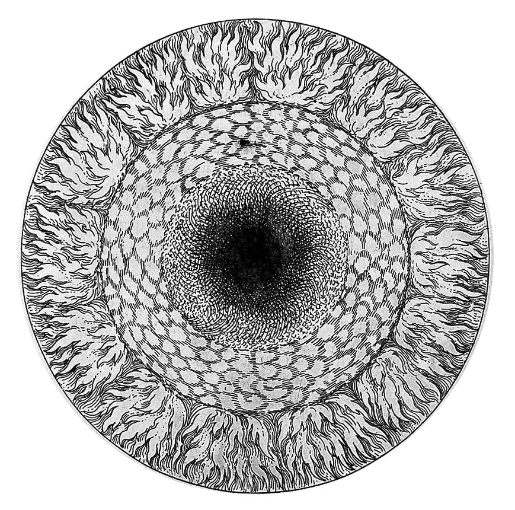

<p align="center">
  
  <br>
  <sub>Robert Fludd, <i>Utriusque Cosmi Maioris … Historia</i> (1617)</sub>
</p>

# DEBAZAROS

DEBAZAROS is a video playback and video-feedback unit. It is made from an
EBAZ4205 board, the control board of a discarded crypto-mining machine, plus a
small adapter PCB with three HDMI connectors. These boards are thrown away by
the thousand, but each one has a Zynq-7010 (two ARM cores and an FPGA) and
256 MB of DDR3. This project puts that hardware to full use, as an
installation of many units on one network.

One unit:

- plays movies or generated images on **two HDMI/DVI outputs**;
- **captures a third HDMI/DVI input** live into memory;
- mixes the two outputs into each other in the FPGA (**video feedback**), with
  gain stages, a per-pixel 3×3 colour matrix, and two oscillators (DDS);
- is controlled over the network with **OSC** (Open Sound Control), and later
  with six buttons and a 6-bit GPIO header.

> Status (Oct 2026): the 2-out/1-in design works on the bench. Hot plug of the
> input is stable. The control daemon and its tools run on the board. See
> [ROADMAP.md](ROADMAP.md) for what comes next.

This repository started as a fork of Guido's
[EBAZ4205 SDR and Spectrum](https://github.com/guido57/EBAZ4205_Spectrum)
project. The radio parts are no longer used; see "Legacy folders" below.

## Hardware

| Part | Notes |
| --- | --- |
| EBAZ4205 | Zynq XC7Z010-1CLG400, 256 MB DDR3, ethernet, SD card. The ethernet PHY gets its 25 MHz clock from the FPGA, so every bitstream must keep that clock. |
| Adapter PCB `pcb/3xHDMI` (rev v2) | Power, three HDMI connectors on the EBAZ DATA1–3 headers, six buttons, header P1 (6 GPIO + 3V3 + GND). KiCad project and a JLCPCB release are in the folder. |
| Ports | HDMI_0 and HDMI_1 are outputs. HDMI_2 is an input (DVI signalling, EDID 720p60 and 1080p30). |

The signals are TMDS at 3.3 V from the FPGA pins (DVI levels). Most HDMI
monitors accept them.

## How it works


| Diagram | Block design / software |
| --- | --- |
| Modulated channel → DVI/HDMI #0 output | `HDMI_0`: `mixerMatrix` (`/mixer/0..8/...`), `colorGainMain` (`/hdmi/0/gain`) |
| Matrix modulator #0–#8 | the 9 mixer channels; the keying modes are mode `0x10`–`0x13` and `0x20`–`0x23` |
| Pixel buffer / pixel delay | BRAM line delay = mixer stream B (`/hdmi/0/delay`) |
| Summed channel → DVI/HDMI #1 output | `HDMI_1`: `/hdmi/1/gain`, `/hdmi/1/osc/sin/...`, `/hdmi/1/osc/phase/...` |
| Feedback per-colour gain | `/hdmi/1/feedback` (output 0 into output 1) |
| Pass-through channel, DVI/HDMI #3 input | `HDMI_2` capture into DDR (`/disp/<d>/capture` shows it) |

The same data from the memory side:

```text
                 DDR3 frame slots (0x0800_0000, 6 slots of 1920x1080x4)
                   │ slot 0 = /dev/fb0             ▲ slot 4 = live input
                   ▼                                │
  ffmpeg ─► fbfeed ─►  VDMA ─► HDMI_0 effects ──┬──► TMDS out 0
  (or drawing)          │      (colour matrix,   │
                        │       mixer, DDS)  ◄───┼─── cross-feed
                        ▼                        │
                       VDMA ─► HDMI_1 effects ◄──┘──► TMDS out 1
                               (feedback gains,
                                oscillator layers)
  HDMI_2 in ─► dvi2rgb ─► vid_in ─► VDMA (write) ─► slot 4
```

- **PS (ARM, Linux):** PetaLinux 2022.2. Programs write frames into reserved
  DDR memory ("slots"). Each display shows one slot. The daemon `debazd` owns
  the FPGA control registers and the slot routing.
- **PL (FPGA):** each output runs a VDMA, a timing generator (shared), an
  effects chain, and a DVI encoder. The two outputs feed each other's final
  pixels back in: that loop makes the video feedback. The input path decodes
  DVI and writes frames to DDR.
- **Control:** OSC over UDP, port 9000. Every control register has a name, for
  example `/hdmi/1/feedback/rgb` or `/mixer/3/mode`.

## Repository map

| Path | What it is |
| --- | --- |
| [`hw/`](hw/README.md) | Gateware as Tcl. `hw/bd/<variant>.tcl` is the source of the block design. `hw/build.tcl` makes the Vivado project, the bitstream, the XSA and `hw_map.h`. |
| [`sw/`](sw/README.md) | All software for the board: `debazd` (control daemon), `dzctl` (OSC client), `hdmi2` (display bring-up), `fbfeed` (frames from a pipe into a slot), `libdz`. Plain `make`, no Vitis project. |
| `ip_repo/`, `IP_dvi2rgb/`, `IP_rgb2dvi/`, `IP_axi_dynclk/` | Custom and Digilent IP cores used by the block design. |
| [`PetaLinux/`](PetaLinux) | PetaLinux configuration (the build machine is separate). `PetaLinux/dtb/` has the device-tree fix for the frame memory. |
| `system-user.dtsi` | Current device-tree additions (frame memory, framebuffer, UIO nodes). |
| `debazarosit.sh`, `debazit.service` | Current start script for the installation. |
| `pcb/3xHDMI/` | Adapter PCB (KiCad). `pcb/3xHDMIv1/` is the first revision. |
| `Vivado/` | The original hand-made Vivado project. Do not edit it; use `hw/`. |
| [ROADMAP.md](ROADMAP.md) | Plan, status and open questions. |
| [CLAUDE.md](CLAUDE.md) | Detailed engineering notes: address map, register fields, measured problems and their causes. |

**Legacy folders** from the radio project, not used: `ad9851*`, `AD9851_test`,
`CIC_FIR*`, `axi_gen_test`, `jt9-flask`, `matlab/`, `qt5/`, `xapp888/`,
`fritzing/`, `docs/`, `Vitis/`.

## Getting started

You need:

- Vivado 2022.2 (for the gateware, and its Vitis gcc for the ARM software);
- a PetaLinux 2022.2 image on the SD card (built elsewhere for now);
- a JTAG cable, or the bitstream in `/lib/firmware` on the board.

### 1. Build the gateware

```sh
vivado -mode batch -source hw/build.tcl -tclargs ebaz4205_2out1in build
# -> build/ebaz4205_2out1in/*.bit, *.bit.bin, *.xsa, hw_map.h
```

See [hw/README.md](hw/README.md) for the edit cycle in the Vivado GUI.

### 2. Build and install the software

```sh
make -C sw            # ARM binaries in sw/out/arm/
make -C sw install    # copy to the board: /home/ebaz/bin/
make -C sw test       # host self test, no hardware needed
```

### 3. Bring up a unit

```sh
# on the board, after boot
echo <bitstream>.bit.bin | sudo tee /sys/class/fpga_manager/fpga0/firmware
sudo devmem 0xF8000008 32 0xDF0D; sudo devmem 0xF80001A0 32 0x00100800  # FCLK3 = 200 MHz
sudo /home/ebaz/bin/hdmi2.elf &      # video mode, VDMAs, capture
sudo /home/ebaz/bin/debazd &         # control daemon
```

`sw/tools/debaz-start.sh` does these steps plus the default mixer setup and a
movie on display 0.

### 4. Control it

```sh
dzctl -s                             # find all units on the network
dzctl -h <ip> /list                  # all control addresses
dzctl -h <ip> /hdmi/1/feedback/rgb 200 40 40
dzctl -h <ip> /dds/0/hz 60
dzctl -h <ip> /disp/0/capture        # show the live input on display 0
dzctl -h <ip> /movie/0/play test24.mp4
```

Any OSC program can send the same messages to UDP port 9000.

## Important cautions

- **Frame memory must be reserved.** The video hardware writes DDR directly.
  If the reserved region is too small, it overwrites Linux memory and programs
  crash. Use the 96 MB device tree in [PetaLinux/dtb](PetaLinux/dtb/README.md).
  128 MB does not work with this U-Boot (the kernel rejects it).
- **Do not reload the FPGA while the input capture runs.** Stop the capture
  first. If you do not, the capture can stay dead until a power cycle.
- **FCLK3 must be 200 MHz** for the input. The FSBL in the current BOOT.BIN
  sets 25 MHz, so set it after each boot (step 3) until BOOT.BIN is rebuilt.
- **Mixer after a reboot:** HDMI_0's output stays black until the mixer is set
  up (`debaz-start.sh` does it).
- All boards from one image have the same MAC address
  (`00:0a:35:00:1e:53`). Give each board its own MAC before you put several
  on one network.

## Credits and license

- Original EBAZ4205 work: Guido ([guido57](https://github.com/guido57)),
  EBAZ4205 SDR and Spectrum.
- DVI IP cores (`dvi2rgb`, `rgb2dvi`, `axi_dynclk`) and the TMDS interface
  definition: [Digilent vivado-library](https://github.com/Digilent/vivado-library), MIT.
- Xilinx IP cores are under their own licenses.

This project: MIT.
